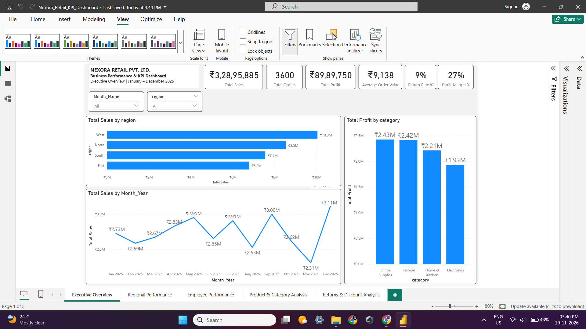
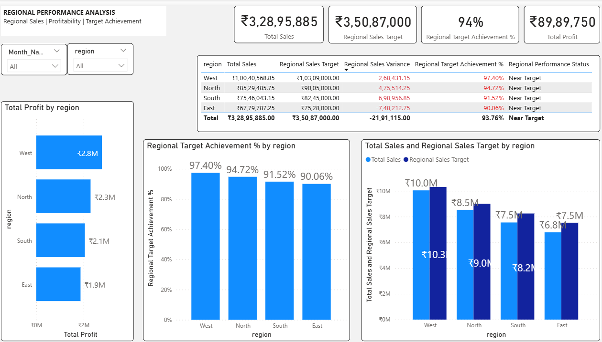
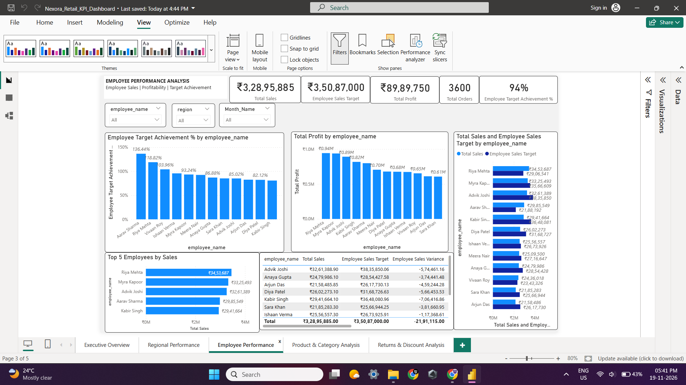
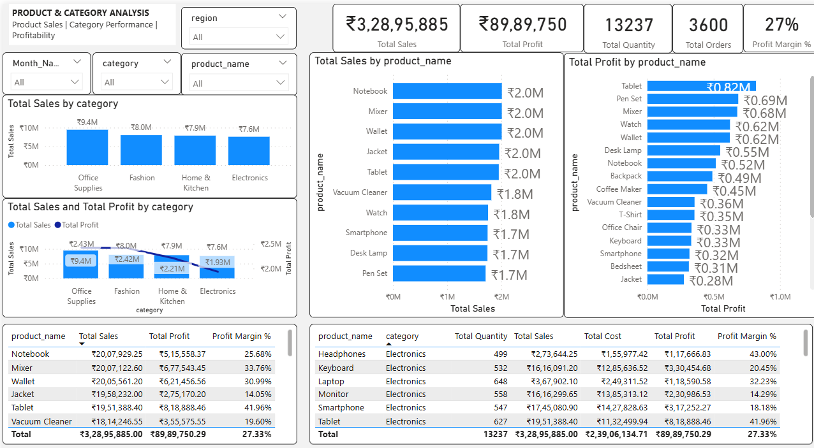
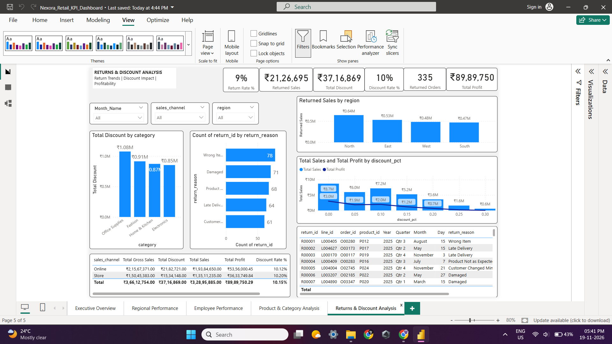

# Nexora Retail Pvt. Ltd. — Business Performance & KPI Reporting System

## Project Overview

This project is an end-to-end business analytics case study developed for **Nexora Retail Pvt. Ltd.**, a simulated retail company.

The objective is to analyse business performance, monitor key performance indicators (KPIs), evaluate regional and employee performance, and identify opportunities to improve sales and profitability.

The project uses Microsoft Excel for data preparation and initial analysis, and Microsoft Power BI for data transformation, modelling, DAX calculations, and interactive dashboard development.

## Business Objectives

- Monitor overall sales, revenue, and profitability.
- Compare actual sales against regional targets.
- Evaluate employee sales performance.
- Analyse product and category performance.
- Monitor product returns and discount impact.
- Provide interactive reports to support business decision-making.

## Tools & Technologies

- **Microsoft Excel:** Data preparation, validation, analysis, KPI calculations, and reporting.
- **Microsoft Power BI:** Data transformation, data modelling, DAX measures, and interactive dashboards.

## Dataset Overview

The project uses six simulated datasets covering the January–December 2025 reporting period.

| Dataset | Records | Description |
|---|---:|---|
| Sales Transactions | 5,257 | Sales transaction details |
| Products | 24 | Product and category information |
| Employees | 12 | Employee details |
| Returns | 342 | Product return records |
| Regional Monthly Targets | 48 | Monthly sales targets by region |
| Employee Monthly Targets | 144 | Monthly sales targets by employee |

## Excel Analysis

Excel was used for data preparation, validation, analysis, and KPI reporting.

Key activities included:
- Reviewing and validating source datasets.
- Preparing structured reporting data.
- Performing sales and profitability analysis.
- Comparing regional and employee performance against targets.
- Analysing discounts and returns.
- Preparing KPI summaries and charts.

## Power BI Dashboard

The Power BI report contains five interactive pages.

### 1. Executive Overview
- Total Sales
- Total Profit
- Total Orders
- Profit Margin
- Average Order Value
- Return Rate
- Monthly Sales Trend
- Sales by Region
- Profit by Category

### 2. Regional Performance
- Regional Sales and Profit
- Regional Sales Targets
- Target Achievement Percentage
- Sales Variance
- Regional Performance Status

### 3. Employee Performance
- Employee Sales and Profit
- Employee Sales Targets
- Target Achievement
- Employee Performance Comparison
- Top 5 Employees by Sales

### 4. Product & Category Analysis
- Sales by Category
- Profit by Product
- Top 10 Products
- Category Sales vs Profit
- Product Performance
- Loss-Making Products

### 5. Returns & Discount Analysis
- Returned Orders
- Returned Sales
- Return Rate
- Total Discount
- Discount Rate
- Returned Orders by Reason
- Discount Impact on Sales and Profit

## Key Performance Indicators

The project includes the following business KPIs:

| KPI | Purpose |
|---|---|
| Total Sales | Measures overall sales revenue |
| Total Profit | Measures business profitability |
| Total Orders | Tracks order volume |
| Total Quantity | Measures units sold |
| Average Order Value | Measures average sales value per order |
| Profit Margin % | Measures profit relative to sales |
| Regional Sales Target | Tracks planned regional sales |
| Target Achievement % | Compares actual sales against targets |
| Employee Sales Target | Tracks employee-level targets |
| Return Rate % | Measures the proportion of returned orders |
| Discount Rate % | Measures discounts relative to gross sales |

## Power BI Features

- Interactive slicers for filtering report data.
- KPI cards for monitoring business performance.
- Relationships between sales, product, employee, returns, calendar, and target tables.
- DAX measures for business calculations.
- Conditional formatting for performance comparisons.
- Page navigation across five report pages.
- Consistent dashboard formatting and layout.

## Project Files

- `data/` — Source CSV datasets.
- `excel/` — Excel analysis workbook.
- `power-bi/` — Power BI dashboard and exported PDF report.
- `screenshots/` — Dashboard page screenshots.

## Project Outcome

This project demonstrates an end-to-end approach to retail business reporting using Excel and Power BI. It brings sales, profitability, regional targets, employee performance, product analysis, returns, and discount information into an interactive reporting solution.

It showcases practical skills in data preparation, data validation, business analysis, KPI reporting, data modelling, DAX, and dashboard development.

## Business Insights & Recommendations

### Key Business Insights

The Nexora Retail analysis focuses on identifying business performance trends across sales, profitability, regional performance, employee productivity, products, returns, and discounts.

The dashboard enables management to:

- Monitor overall revenue, profit, order volume, and profit margins.
- Compare actual regional sales against monthly targets.
- Identify employees with strong and weak target achievement.
- Identify products and categories contributing to sales and profitability.
- Monitor product returns and understand their impact on business performance.
- Evaluate how discounting affects sales and profitability.
- Track month-over-month revenue growth to understand changes in business performance.

### Business Recommendations

1. **Improve Regional Performance:** Review regions that consistently fall below their sales targets and develop focused improvement plans.

2. **Strengthen Employee Productivity:** Identify employees with lower target achievement and provide appropriate support, training, and performance monitoring.

3. **Review Product Profitability:** Investigate loss-making products and evaluate their pricing, costs, and discount strategies.

4. **Monitor Discount Strategies:** Review high-discount transactions to ensure that discounts contribute positively to business performance.

5. **Reduce Product Returns:** Analyse common return reasons and take corrective action to reduce avoidable returns.

6. **Monitor Monthly Revenue Growth:** Review month-over-month revenue changes to identify positive trends and investigate periods of declining performance.

### Management Reporting Value

The reporting system provides management with a consolidated view of business performance through Excel analysis and interactive Power BI dashboards, supporting informed decisions and continuous performance monitoring.
---

**Project Type:** Data Analytics Portfolio Project  
**Business:** Nexora Retail Pvt. Ltd. (Simulated)  
**Reporting Period:** January–December 2025  
**Tools:** Microsoft Excel | Microsoft Power BI
